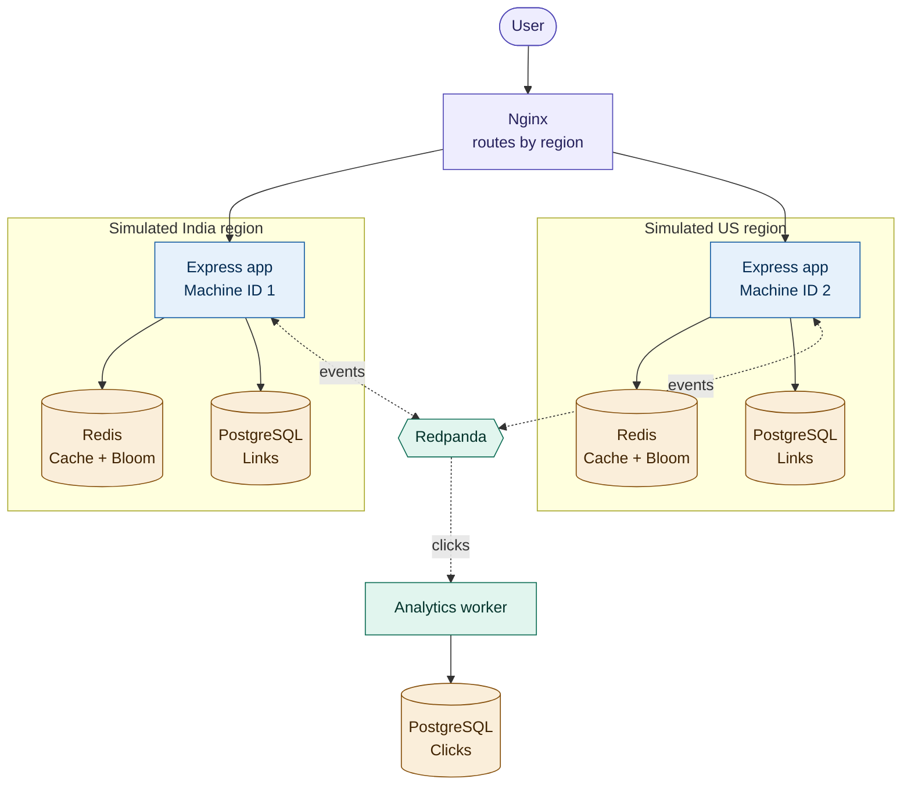
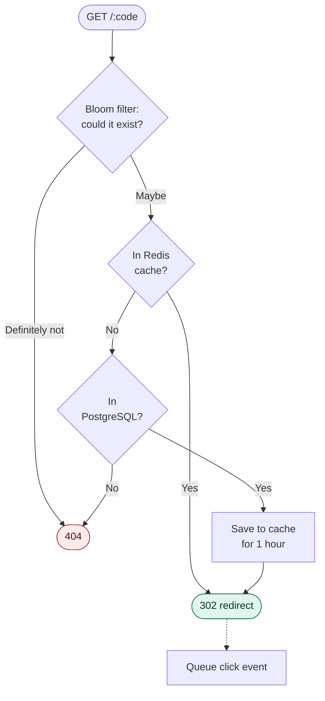
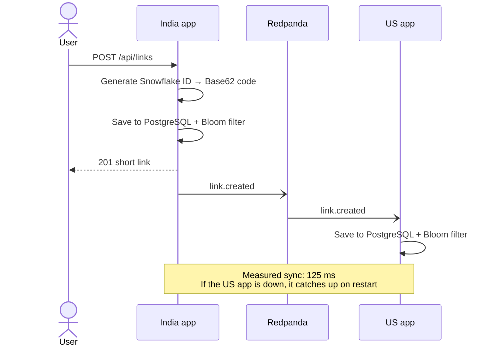
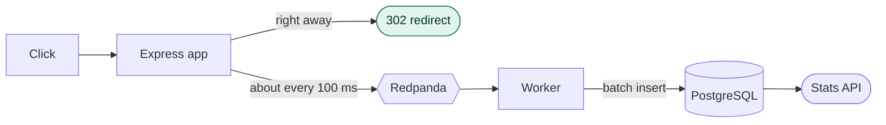
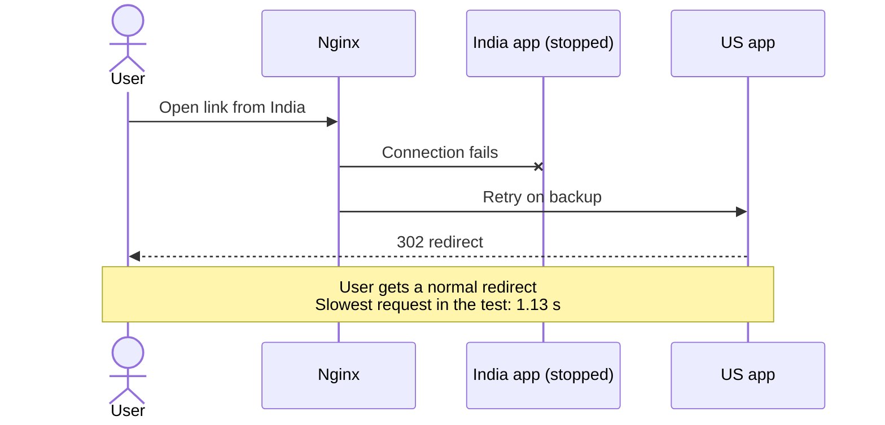
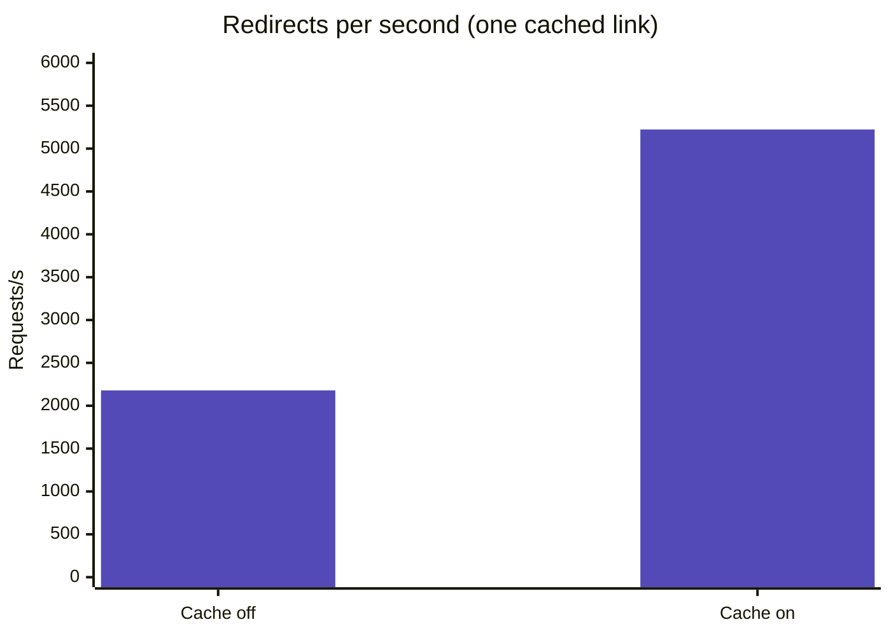
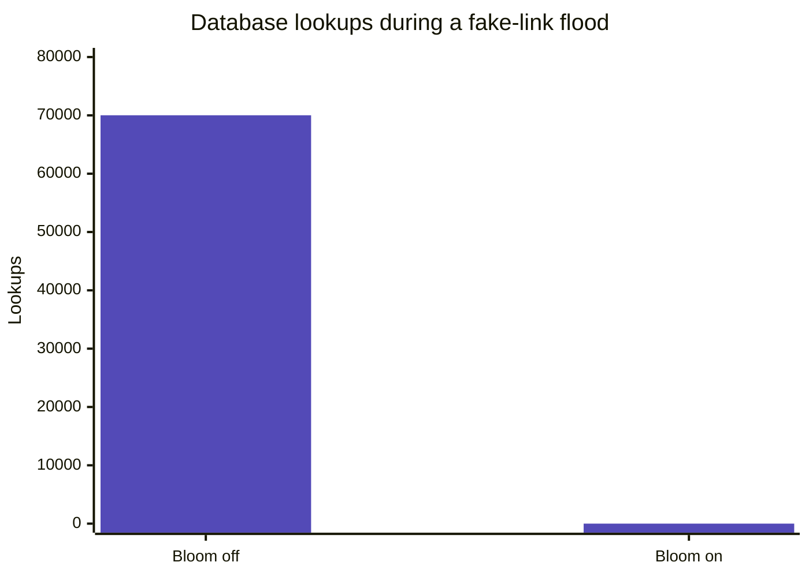

# Geo-Distributed URL Shortener

A URL shortener designed for multiple regions, then **load-tested and failure-tested** to see how it behaves.


| 🚀 Cache | 🛡️ Bloom filter | 📊 Analytics | 🔁 Failover |
|:--:|:--:|:--:|:--:|
| **2.4x** throughput | **0** DB lookups for 122K fake links | **151,733 of 151,733** clicks saved | **0 of 58,930** requests failed |

> **Test setup:** two regions simulated with Docker on one 4-core laptop. Use these numbers to compare designs, not to estimate production capacity.

---

## Architecture



---

## Opening a short link

Most fake links stop at the first check. Popular links stop at the second.



---

## Creating a link and syncing regions

Each region creates links on its own. Snowflake IDs stop two regions from creating the same ID.



**Inside a 64-bit Snowflake ID**

| 1 bit | 41 bits | 10 bits | 12 bits |
|:--:|:--:|:--:|:--:|
| Unused | Timestamp | Machine ID | Sequence |

---

## Recording clicks

The user gets redirected first, and the click is saved in the background.



A unique `event_id` means a click isn't counted twice if the worker processes a message again.

---

## Failover

Each region uses the other as its backup.



---

## Test results

All tests used k6 with 20 virtual users.

### Redis cache



| | Cache off | Cache on | Change |
|---|:-:|:-:|:-:|
| Requests/s | 2,179 | **5,223** | **2.4x** |
| p95 latency | 19.84 ms | **8.85 ms** | **55% lower** |

### Bloom filter



| | Bloom off | Bloom on | Change |
|---|:-:|:-:|:-:|
| Fake-link requests | 70,015 | 122,442 | |
| DB lookups | 70,016 | **0** | **100% fewer** |
| Requests/s | 2,335 | **4,082** | **1.75x** |
| p95 latency | 16.38 ms | **10.74 ms** | **34% lower** |

*The filter was almost empty in this test. A full filter is sized to let about 1% of fake links through.*

### Async analytics

| | Analytics off | Analytics on | Cost |
|---|:-:|:-:|:-:|
| Requests/s | 5,533 | 5,058 | 9% fewer |
| Average latency | 3.50 ms | 3.84 ms | **+0.34 ms** |
| p95 latency | 6.44 ms | 7.69 ms | +1.25 ms |

**Clicks saved:** 151,733 of 151,733.

### Both regions together

| Test | Requests | Failed | Redirect p95 | Links in India / US | Clicks saved |
|---|:-:|:-:|:-:|:-:|:-:|
| Mixed traffic | 38,498 | **0** | 31.13 ms | 1,963 / 1,963 | 34,588 of 34,588 |
| India app stopped under load | 58,930 | **0** | 46.61 ms | 5,075 / 5,075 | 87,402 of 87,438 |

- **Mixed traffic:** 90% redirects, 5% fake links, and 5% new links.
- **Failover:** only the India app was stopped. Its Redis and PostgreSQL kept running.
- **Lost clicks:** 36 clicks (0.07%) were lost, most likely because they were still in the stopped app's memory.

---

## Design decisions

| Decision | Why | Trade-off |
|---|---|---|
| **Snowflake IDs** | Regions don't need to coordinate | 10-character codes that can be guessed |
| **Bloom filter** | Protects the database from fake links | About 1% false positives when full |
| **Cache-aside** | Popular links skip the database | Redis is one more service to run |
| **Event-based sync** | Simpler than two-way database replication | Brief delay before a link works everywhere |
| **Immutable links** | Regions have nothing to conflict over | Links can't be edited |
| **302 redirects** | Every click reaches the server | More traffic than a cacheable 301 |
| **In-memory event buffer** | Redirects don't wait for Redpanda | A crash can lose queued events |

---

## Run it

**You need:** Docker Desktop.

```bash
git clone https://github.com/Harshitgupta0509/url-shortener.git
cd url-shortener
docker compose up -d --build
```

The API runs on `http://localhost:8080`. Give it about 30 seconds to start.

```bash
# Create a link in India
curl -X POST http://localhost:8080/api/links \
  -H "Content-Type: application/json" \
  -H "X-Region: india" \
  -d '{"url":"https://github.com"}'

# Open it from the US
curl -i -H "X-Region: us" http://localhost:8080/YOUR_CODE
```

**Run the load test:**

```bash
docker run --rm -i grafana/k6 run - < k6/final.js
```

*These commands are for a Bash terminal. In PowerShell, use `curl.exe` for requests and `Get-Content k6\final.js -Raw | docker run --rm -i grafana/k6 run -` for k6.*

---

## API

| Method | Route | Purpose |
|---|---|---|
| `POST` | `/api/links` | Create a short link |
| `GET` | `/:code` | Redirect to the original URL |
| `GET` | `/api/links/:code/stats` | See clicks by region, country, and device |

Send `X-Region: india` or `X-Region: us` to choose a region.

---

## Limitations

- **Simulated regions:** everything runs on one machine, so there's no real network delay between regions.
- **Possible missed links:** a crash can lose a queued link event before the other region receives it.
- **Short test runs:** each comparison ran once for 30 to 60 seconds.

## What's next

- [ ] Add an outbox table so link events survive a crash
- [ ] Deploy to real cloud regions
- [ ] Test with larger, more realistic traffic
- [ ] Use real location data instead of the `X-Country` test header
